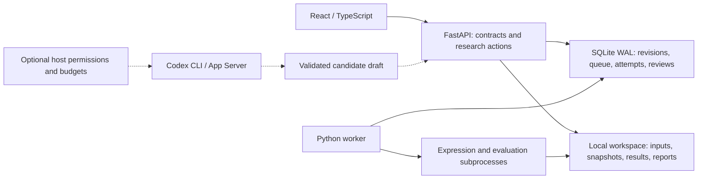

# Paper-to-Alpha Research Agent

A local research workbench that connects paper evidence, alpha hypotheses, executable factor expressions, and reproducible evaluation results.

The project grew from a personal research workflow used during WorldQuant competition participation: find a paper, extract an idea, implement a factor, evaluate it, and revise the research. It turns those steps into a full-stack application with explicit versions, execution records, and review decisions. WorldQuant is the research context, not an employment relationship or project affiliation.

**Version:** 0.27.1 · **Database:** schema 29 · **Delivery scope:** local macOS, single user, loopback access. The default workflow requires no model account.

## What the project demonstrates

- **Full-stack workflow:** React and TypeScript connect materials, evidence, candidates, experiments, and result review through typed FastAPI contracts.
- **Reliable background execution:** a SQLite queue and a separate Python worker retain attempts, events, failures, cancellation, and execution budgets after the browser closes.
- **Traceable research:** source pages and quotations, scientific attribution, saved revisions, input and code snapshots, result hashes, and frozen reports remain linked.
- **Controlled factor execution:** an AST-based expression whitelist checks fields, operators, windows, complexity, and exact panel alignment before calculation.
- **Recoverable state:** transactional idempotency receipts prevent duplicate writes after lost responses; offline backup and restore preserve research history.
- **Bounded automation:** deterministic corrections handle specific equivalent representations. An optional model adapter produces reviewable candidate drafts under host-controlled permissions and budgets.

## Five-stage workflow

| Stage | User action | Saved output |
| --- | --- | --- |
| 1. Material | Register a text-extractable PDF and a declared dataset | Source identity, checksum, physical PDF pages, dataset metadata |
| 2. Hypotheses and evidence | Record quotations, hypotheses, mechanisms, and assumptions | Evidence IDs and attribution: paper original, user modification, or model conjecture |
| 3. Candidates | Define expressions and inspect field/operator requirements | Validated candidate definitions and an immutable research revision |
| 4. Experiments | Explicitly submit a saved revision | Queued run, execution attempts, events, tool results, and diagnostics |
| 5. Result review | Inspect charts and evidence; accept, revise, or reject | Reviews, issues, approved regression cases, new revisions, and frozen reports |

Reports export the saved research and experiment facts. A revision or review does not overwrite an earlier result.

## Architecture



The API serves the built frontend and JSON endpoints on the same origin. The browser polls saved status and events; the worker owns computation. Model proposals pass contract, evidence, attribution, expression, and field checks before explicit adoption and normal worker execution.

| Layer | Technology |
| --- | --- |
| Interface | React 19, TypeScript, Vite, SVG charts, KaTeX/MathML |
| API and contracts | Python, FastAPI, Uvicorn, Pydantic, OpenAPI, generated TypeScript contracts |
| Calculation and evidence | pandas, NumPy, pypdf, restricted expression DSL |
| State and execution | SQLite WAL, transactions, filesystem locks, subprocesses, worker heartbeats |
| Optional model transport | Codex CLI Exec or App Server over stdio JSON-RPC; fixture provider |
| Verification | Python unittest, FastAPI TestClient/HTTPX, Vitest, Playwright |

See [architecture and execution design](docs/architecture.md) for object relationships and failure handling. Some factor and operator code was adapted from the author's earlier personal project; its provenance is retained in [third-party and reuse notices](THIRD_PARTY_NOTICES.md).

## Install from source

The locally accepted environment uses **Python 3.14 on macOS**. The package declares Python `>=3.11`, but that declaration is not acceptance evidence for every interpreter or OS. Node.js 24.16 was used for the publication build; Vite requires `^20.19.0` or `>=22.12.0`. Node and npm are used for frontend development and build, not as the backend server.

```sh
git clone https://github.com/Owenqi666/quant-ai-agent.git
cd quant-ai-agent
python3.14 -m venv .venv
.venv/bin/python -m pip install -r requirements-web-lock.txt
.venv/bin/python -m pip install -e '.[web,test]'
cd frontend
npm ci
npm run build
cd ..
```

The locks pin the Python and frontend dependencies. The runtime has no CDN dependency after the frontend is built.

## Quick experience

An original tutorial document and synthetic OHLCV data provide a complete CLI example without a model call or a third-party paper download:

```sh
.venv/bin/python scripts/prepare_public_demo.py --output-dir .demo/inputs
.venv/bin/python -m paper_alpha run .demo/inputs/task.json --mode fixed --out .demo/run
.venv/bin/python -m paper_alpha verify .demo/run
```

Read `.demo/run/report.md` for computed results and diagnostics. The preparation script creates inputs; the ordinary worker tools calculate the metrics. Use fresh output directories for another run. The candidate is a toy definition, and the data are synthetic.

To open the full interface, start a separate local workspace:

```sh
.venv/bin/python -m paper_alpha.server.launcher --home ./var/demo --port 8765
```

Open [the local workbench](http://127.0.0.1:8765/) and [the API reference](http://127.0.0.1:8765/docs). The launcher starts the API and worker together. `Ctrl+C` stops both; submitted state remains in `var/demo`. Use the material and research creation forms for your own prepared inputs; the CLI demo does not automatically seed a browser research record.

For the built-in Alpha101 browser example, obtain the fixed original paper from [arXiv, version 3](https://arxiv.org/abs/1601.00991v3), subject to its terms, and prepare it locally before importing the example:

```sh
.venv/bin/python scripts/prepare_alpha101.py --pdf /path/to/1601.00991v3.pdf
```

The script verifies the pinned PDF before extracting source material for the existing templates. The paper PDF and extracted full text are not distributed here. Alpha101 examples use synthetic data; they do not reproduce the paper's trading results. See [example preparation](examples/README.md).

## Evaluation and automation boundaries

The main daily workflow performs **factor research evaluation**. Signals formed after session `t` close are evaluated against `open[t+2] / open[t+1] - 1`, with all three sessions inside the selected validation interval. Outputs include mean Rank IC, daily gross returns, coverage, and explicit valid/skipped/boundary counts. Cumulative gross return is an arithmetic sum, not compounded NAV.

Costs, slippage, borrow, fills, liquidity, and capacity are not modeled. These results are not a complete trading backtest, WorldQuant BRAIN simulation, or evidence of a profitable strategy. The public demo is synthetic. See [evaluation semantics](docs/evaluation.md).

Deterministic correction is limited to declared equivalents such as `correlation → ts_corr` and policy-approved integral window representations. It cannot invent missing data, replace required fields, change economic mechanisms, or optimize financial results.

Model dispatch is **off by default**. The App Server transport currently supports optional `generate_candidates` only; host configuration, current qualification, and call budgets are required. A limited historical live generation and worker handoff were verified locally. That does not establish arbitrary-paper understanding or general model self-repair. Automated retrieval/RAG/OCR, automatic BRAIN simulation, certified point-in-time real equity data, and multiuser production operation are outside the delivered scope.

Advanced monthly, author-material, and archived evaluation workflows require separately prepared source inputs. Private historical research material is excluded from this publication; those workflows are not preloaded demonstrations in a clean clone.

## Tests and recovery

This publication includes representative tests for expression safety and alignment, evaluation timing and missing-data behavior, formula presentation, mutation idempotency, and workspace backup/restore. It does not bundle historical validation outputs or configure remote CI. Bounded checks of this export are documented in [publication validation](docs/publication-validation.md).

The following tests do not require a third-party paper:

```sh
.venv/bin/python -m unittest discover -s tests -p 'test_expressions.py'
.venv/bin/python -m unittest discover -s tests -p 'test_evaluation.py'
.venv/bin/python -m unittest discover -s tests -p 'test_formula_presentation.py'
```

After local Alpha101 preparation, run the paper-dependent integration and recovery tests:

```sh
.venv/bin/python -m unittest discover -s tests -p 'test_mutation_idempotency.py'
.venv/bin/python -m unittest discover -s tests -p 'test_backup.py'
```

Test results establish software behavior within their fixtures, not financial effectiveness or measured user productivity.

Stop all processes using a workspace before maintenance. Backups use a consistent SQLite snapshot and a checksummed file manifest; restore always targets a new directory. See [backup, restore, and upgrade](docs/recovery.md) for commands and recovery limits.

## Repository scope

This repository is a curated source publication of the maintained application, dependency locks, build and preparation tools, selected tests, and public examples. User databases, research records, accounts, credentials, permissions, enabled host configurations, logs, environments, historical experiments, validation artifacts, and local version backups are excluded.

See the [publication inventory and optional-source requirements](docs/publication-scope.md) for the exact classification. The separately accepted local Runtime and its frozen signoff remain local. Public source availability does not grant redistribution rights for external papers or datasets. No project-wide open-source license has been selected; dependency licenses remain with their respective owners. See [THIRD_PARTY_NOTICES.md](THIRD_PARTY_NOTICES.md).
