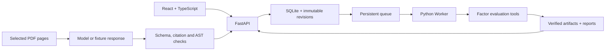

# Paper-to-Alpha

An evidence-linked factor research workbench: turn selected source material into reviewable model proposals, then validate and evaluate them with deterministic tools.

[](https://github.com/Owenqi666/quant-ai-agent/actions/workflows/public-ci.yml?query=branch%3Amain)


The project grew from my WorldQuant competition research workflow: read a paper, form an alpha idea, implement a factor, evaluate it, and revise the research. I built a local workbench to keep the source, assumptions, implementation and results connected. WorldQuant is the research context, not a project affiliation or employment relationship.

## See a complete example

The public Agent demo uses an original teaching note defining a simple `close - open` signal and deterministic synthetic OHLCV. It runs without a model account or an external paper download.

| Input / stage | Output you can inspect |
| --- | --- |
| Select pages from the original teaching PDF | File digest, physical pages and extracted text |
| Fixture extraction response | Parsed quotations, evidence IDs, structured hypothesis and unresolved scientific questions |
| Explicit host configuration | Separate automation binding version, saved material and recorded timing/data assumptions |
| Fixture candidate response | Expression, source hypothesis and required fields |
| Deterministic validation and persisted execution | AST checks, queued run, original Worker, calculated factor and evaluation results |
| Result verification and export | Independent numerical checks and a frozen report |

**Fixture** means hand-authored response fixtures replace inference. **Synthetic** describes the market data. The response parser, source checks, experiment controller, queue, Worker and reporting code are the application paths. Component bindings are explicitly authored by the demo host in a new version; they are not claimed as fixture model output. An additional response with invalid request identity fails the same parser; it never creates a successful experiment. See [the reproducible demo](docs/public-agent-demo.md).

## Engineering decisions

- **Constrained execution.** An AST whitelist checks data fields, operators, windows and complexity before factor calculation. Exact panel alignment and declared next-session timing prevent silent broadcasting and enforce the configured evaluation boundaries. [Expression engine](paper_alpha/expressions.py) · [evaluation semantics](docs/evaluation.md).
- **Requests that survive lost responses.** Transactional idempotency receipts return the original result for a repeated request. A SQLite queue separates browser activity from execution, and the Worker retains attempts, events, cancellation and interrupted state. [Mutation receipts](paper_alpha/server/mutations.py) · [Worker](paper_alpha/server/runner.py) · [recovery](docs/recovery.md).
- **Traceability across revisions.** PDF locations, evidence, hypotheses, expressions, input/code snapshots and result hashes remain linked. Review decisions produce new records; they do not silently rewrite old results. [Material versions](paper_alpha/server/paper_materials.py) · [result verification](paper_alpha/workflow.py).
- **Model drafts behind deterministic gates.** Models propose evidence/hypotheses and candidates. Programs parse responses, check citations and expressions, run calculations and verify outputs. A finite definition recognizer can repair missing references from already selected spans in a separate automation version. Unsupported or ambiguous definition text remains unresolved; this is not a general semantic entailment checker. [Provider workflow](docs/model-workflow.md) · [definition checks](paper_alpha/server/operator_definition_grounding.py).

## My contribution and reuse

I implemented the full-stack workbench, typed API contracts, source/material versions, bounded proposal workflow, persisted experiment handoff, execution/recovery lifecycle, review/reporting interfaces and reproducible verification tooling. The integration connects model-generated drafts to controlled factor evaluation rather than letting the model invent metrics or approve its own output.

The factor/operator implementation includes code adapted from my earlier personal factor project. React, FastAPI, pandas, NumPy and other dependencies provide the underlying libraries. The reuse boundary and checksums are documented in [component provenance](THIRD_PARTY_NOTICES.md); this is not a claim that every numerical primitive was written from scratch.

## Architecture and stack



Python / pandas / NumPy calculate factors and evaluation metrics; FastAPI exposes typed endpoints; React / TypeScript / Vite provide the workbench. SQLite WAL and filesystem artifacts support a **local, single-user** workflow. The queue is not a distributed service. [Detailed architecture](docs/architecture.md).

## Quick start

The public CI targets **Ubuntu 24.04, Python 3.14 and Node.js 24**. Local development also uses Python 3.14 on macOS. The package's wider interpreter declaration does not establish acceptance for other combinations.

```sh
git clone https://github.com/Owenqi666/quant-ai-agent.git
cd quant-ai-agent
python3.14 -m venv .venv
.venv/bin/python -m pip install -r requirements-web-lock.txt
.venv/bin/python -m pip install --no-deps -e .
npm --prefix frontend ci
npm --prefix frontend run build
```

Run the Agent demonstration and its independent check:

```sh
.venv/bin/python scripts/demo_public_agent.py --output-dir .demo/agent
.venv/bin/python scripts/check_public_agent_demo.py --output-dir .demo/agent
```

The demo saves its source, requests/responses, material versions, validation, run and computed report under `.demo/agent`. It retains the rejected response alongside the successful chain. Output directories are exclusive; use another path for a new run.

Open that same research in the browser:

```sh
.venv/bin/python -m paper_alpha.server.launcher --home .demo/agent/workspace --port 8765
```

Visit [the workbench](http://127.0.0.1:8765) or [the API reference](http://127.0.0.1:8765/docs). The launcher serves the built frontend and starts the existing Worker. `Ctrl+C` stops the services; saved research remains in the workspace. No real-model permission is enabled by this command. Product review controls remain available; the public demo records no participant approval.

The earlier fixed-candidate CLI example is also available via `scripts/prepare_public_demo.py`; it is separate from the Agent demonstration above.

## Tests and CI

```sh
.venv/bin/python scripts/export_api_contract.py --check
.venv/bin/python -m unittest tests.test_expressions tests.test_evaluation \
  tests.test_formula_presentation tests.test_paper_segments \
  tests.test_formula_engineering_material tests.test_operator_definition_public \
  tests.test_public_reliability tests.test_public_agent_demo
npm --prefix frontend run typecheck
npm --prefix frontend test
npm --prefix frontend run build
```

[Public CI](.github/workflows/public-ci.yml) installs locked Python and npm dependencies in a fresh runner, checks API contract drift, runs public regressions and reliability tests, builds the frontend, and runs the Agent demo plus its numerical check. Logs and selected demonstration artifacts are uploaded for inspection. These tests require no model credentials, private database or third-party paper. [Validation scope](docs/publication-validation.md).

## Scope and further reading

Model dispatch is disabled by default. The optional real App Server transport supports evidence/hypothesis extraction and candidate generation under explicit host permissions and budgets. The public demonstration exercises the supported fixture response protocol; it does not count as a real LLM call. Historical local real-call evidence is described separately in [the model workflow](docs/model-workflow.md) and is not a new-version CI result.

The application performs **factor evaluation**, not a complete trading backtest. Synthetic results do not prove investment returns, general paper understanding or research efficiency gains. Human research-quality and time-comparison evaluation remain unmeasured. Automated exact-text or definition checks are separate from a person's semantic judgment.

[Evaluation rules](docs/evaluation.md) · [backup/recovery](docs/recovery.md) · [public source boundary](docs/publication-scope.md) · [change history](CHANGELOG.md).
