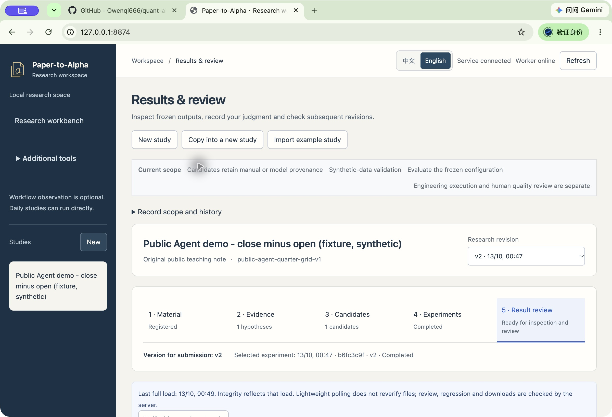
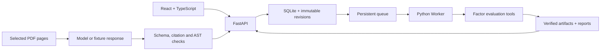

# Paper-to-Alpha

An evidence-linked factor research workbench: turn selected source material into reviewable model proposals, then validate and evaluate them with deterministic tools.

[](https://github.com/Owenqi666/quant-ai-agent/actions/workflows/public-ci.yml?query=branch%3Amain)



*Computed output panel · fixture responses · synthetic OHLCV.*

The project grew from my WorldQuant competition research workflow: read a paper, implement a factor, evaluate it, and revise the idea. I built a local workbench to keep the source, assumptions, implementation and results connected. WorldQuant is the research context, not a project affiliation or employment relationship.

## Engineering decisions

- **Constrained numerical execution.** An AST whitelist checks fields, operators, windows and complexity. Exact panel alignment and declared next-session timing enforce evaluation boundaries. Rolling correlation retains its exact boundary fallback; regression tests compare NaN masks and non-NaN bits, including signed zero, against the retained implementation. [Expression engine](paper_alpha/expressions.py) · [evaluation semantics](docs/evaluation.md).
- **Requests that survive lost responses.** Transactional idempotency receipts return the original result for a repeated request. A SQLite queue separates browser activity from execution, and the Worker retains attempts, events, cancellation and interrupted state. [Mutation receipts](paper_alpha/server/mutations.py) · [Worker](paper_alpha/server/runner.py) · [recovery](docs/recovery.md).
- **Traceability across revisions.** PDF locations, evidence, hypotheses, expressions, input/code snapshots and result hashes remain linked. Review decisions produce new records; they do not silently rewrite old results. [Material versions](paper_alpha/server/paper_materials.py) · [result verification](paper_alpha/workflow.py).
- **Model drafts behind deterministic gates.** Models propose evidence, hypotheses and candidates; programs parse responses, check citations and expressions, calculate results and verify outputs. Supported definition bindings can be completed from selected spans in a separate automation version. [Provider workflow](docs/model-workflow.md) · [definition checks](paper_alpha/server/operator_definition_grounding.py).

On an Apple M5 Pro, seeded synthetic 1,000-date × 200-asset ordinary inputs showed median `ts_corr` speedups of **39.475×** (window 20) and **22.208×** (window 60) over the retained reference. [Measurement method, boundary costs and raw evidence](docs/ts-corr-benchmark.md).

## See a complete example

The public Agent demo uses an original teaching note defining `close - open` and deterministic synthetic OHLCV. It runs without a model account or an external paper download.

| Stage | Output you can inspect |
| --- | --- |
| Select pages from the original teaching PDF | File digest, physical pages and extracted quotations |
| Fixture proposal and explicit host configuration | Evidence, hypothesis, preserved material versions and recorded engineering assumptions |
| Validate the candidate and execute | Expression, AST checks, persisted queue, original Worker, factor panel and evaluation |
| Verify and export | Independent arithmetic and artifact checks, saved computation and frozen report |

Hand-authored **fixture responses** replace inference; **synthetic** describes the market data. Normal parsing, experiment validation, queue, Worker and reporting paths execute. The host adds component bindings in a separate automation version; these are not model output. A malformed request identity is retained as failed `REQUEST_MISMATCH`. [Reproduce and inspect the demo](docs/public-agent-demo.md).

## Quick start

The public CI targets **Ubuntu 24.04, Python 3.14 and Node.js 24**. Local development also uses Python 3.14 on macOS. The package's wider interpreter declaration does not establish acceptance for other combinations.

```sh
git clone https://github.com/Owenqi666/quant-ai-agent.git
cd quant-ai-agent
python3.14 -m venv .venv
.venv/bin/python -m pip install -r requirements-web-lock.txt
.venv/bin/python -m pip install --no-deps -e .
npm --prefix frontend ci
npm --prefix frontend run build
```

Run the Agent demonstration and its independent check:

```sh
.venv/bin/python scripts/demo_public_agent.py --output-dir .demo/agent
.venv/bin/python scripts/check_public_agent_demo.py --output-dir .demo/agent
```

The demo saves its source, requests/responses, material versions, validation, run and computed report under `.demo/agent`. It retains the rejected response alongside the successful chain. Output directories are exclusive; use another path for a new run.

Open that same research in the browser:

```sh
.venv/bin/python -m paper_alpha.server.launcher --home .demo/agent/workspace --port 8765
```

Visit [the workbench](http://127.0.0.1:8765) or [the API reference](http://127.0.0.1:8765/docs). The launcher serves the built frontend and starts the existing Worker. `Ctrl+C` stops the services; saved research remains in the workspace. No real-model permission is enabled by this command. Product review controls remain available; the public demo records no participant approval.

The earlier fixed-candidate CLI example is also available via `scripts/prepare_public_demo.py`; it is separate from the Agent demonstration above.

## Tests and CI

```sh
.venv/bin/python scripts/export_api_contract.py --check
.venv/bin/python scripts/run_public_tests.py --output .ci/python-tests.json
.venv/bin/python scripts/benchmark_ts_corr.py --suite smoke \
  --warmups 5 --repeats 5 --output-dir .ci/ts-corr-smoke
npm --prefix frontend run typecheck
npm --prefix frontend test
npm --prefix frontend run build
```

[Public CI](.github/workflows/public-ci.yml) installs locked dependencies, checks API contract drift, discovers all exported core Python tests, runs the correlation compatibility matrix and performance smoke, checks/builds the frontend, and runs the Agent demo plus its independent checker. Empty collections, skips and expected failures fail the core gate; speed has no CI threshold. Use a new benchmark output path for each run. [Reproduction and artifacts](docs/public-ci.md) · [observed validation](docs/publication-validation.md).

## My contribution and reuse

I implemented the full-stack workbench, typed API contracts, source/material versions, bounded proposal workflow, persisted experiment handoff, execution/recovery lifecycle, review/reporting interfaces and reproducible verification tooling. The integration connects model-generated drafts to controlled factor evaluation rather than letting the model invent metrics or approve its own output.

The factor/operator implementation includes code adapted from my earlier personal factor project. React, FastAPI, pandas, NumPy and other dependencies provide the underlying libraries. The reuse boundary and checksums are documented in [component provenance](THIRD_PARTY_NOTICES.md); this is not a claim that every numerical primitive was written from scratch.

## Architecture and stack



Python / pandas / NumPy calculate factors and evaluation metrics; FastAPI exposes typed endpoints; React / TypeScript / Vite provide the workbench. SQLite WAL and filesystem artifacts retain the local workflow. [Detailed architecture](docs/architecture.md).

## Limitations

Model dispatch is disabled by default. The optional real App Server transport supports evidence/hypothesis extraction and candidate generation under explicit host permissions and budgets. The public demonstration exercises the supported fixture response protocol; it does not count as a real LLM call. Historical local real-call evidence is described separately in [the model workflow](docs/model-workflow.md) and is not a new-version CI result.

This is a **local, single-user factor-evaluation workbench**. Its queue is not a distributed service, and factor evaluation is not a complete trading simulation. Definition checks recognize finite supported forms; unsupported or ambiguous text remains unresolved. They do not establish general semantic entailment or human judgment.

Synthetic results and measured operator speedups do not prove investment returns, general paper understanding or research efficiency gains. Human research-quality and time-comparison evaluation remain unmeasured. Numerical compatibility passed the recorded same-environment matrix; finite tests do not prove equivalence for every legal input.

[Evaluation rules](docs/evaluation.md) · [backup/recovery](docs/recovery.md) · [public source boundary](docs/publication-scope.md) · [change history](CHANGELOG.md).
