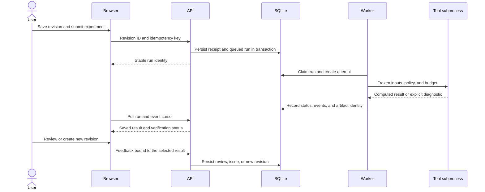

# Architecture and execution design

Paper-to-Alpha 0.27.2 is a local, single-user workbench with database schema 29. Python hosts both the application API and the research tools; Node.js is used to build the frontend. SQLite and files in an explicit workspace hold persistent user state.

## Components

| Component | Responsibility | Source entry points |
| --- | --- | --- |
| Browser | Five-stage workflow, drafts, experiment selection, polling, result charts, reviews | `frontend/src/App.tsx`, `frontend/src/components/DailyWorkflow.tsx` |
| API | Typed requests/responses, source registration, revisions, experiment submission, result/report reads | `paper_alpha/server/api.py`, `paper_alpha/server/schemas.py` |
| Store | Transactions, object identity, immutable revisions, idempotent mutations, saved history | `paper_alpha/server/service.py`, `paper_alpha/server/db.py`, `paper_alpha/server/mutations.py` |
| Worker | Claim persisted work, create attempts, supervise tool processes, retain terminal state | `paper_alpha/server/runner.py`, `paper_alpha/server/execution_lifecycle.py` |
| Research tools | Exact-span and source-definition checks, expression validation, strict data loading, factor calculation, evaluation | `paper_alpha/evidence.py`, `paper_alpha/expressions.py`, `paper_alpha/workflow.py`, `paper_alpha/evaluation.py` |
| Optional provider | Selected-page material extraction, candidate drafts, supervised native transport, host qualifications and budget accounting | `paper_alpha/server/provider_schema.py`, `paper_alpha/server/provider_app_server_invocation.py` |

FastAPI serves the built React application and its API from the same loopback origin. Browser event refresh uses paginated polling. SQLite WAL, foreign keys, transactions, workspace locks, and worker/attempt identities coordinate execution on one machine; this is not a distributed queue.

## An experiment's path

Saving a research revision and submitting an experiment are separate actions. An experiment retains the exact submitted revision even when a newer revision is selected in the interface. Closing the browser does not stop the worker.

## Data model and provenance

| Objects | Retained relationship |
| --- | --- |
| Paper -> Selection -> Evidence | PDF checksum, selected physical pages, bounded normalized Unicode spans, exact quotation offsets |
| Material -> MaterialVersion | Original extracted draft, component-level evidence bindings, unresolved rules, and separately adopted or automated versions |
| Evidence -> Hypothesis -> Candidate | Claim, mechanism, assumptions, required fields, expression, origin, and declared changes |
| Research -> Revision -> Run -> Attempt | Versioned task, frozen submitted revision, execution policy, worker ownership, and attempt identity |
| Attempt -> Event / Artifact | Ordered execution history, file size, SHA256, and saved result |
| Result -> Review -> Issue / RegressionCase | Exact run, revision, attempt, candidate, and result digest; explicitly approved expectations |
| ResearchReport | Frozen payload referencing source, experiment, failures, reviews, issues, and regression checks |
| Provider Session / Proposal / Reservation | Request context, call slot, dispatch attempt, response, receipt, and decision history |

Material bindings separately identify support for a claim, economic mechanism, calculation, mathematical signal direction, required data, and conditions. Operators belong in calculation support rather than the data-field list. The host restores selected-span quotations from its own source snapshot instead of trusting the model to reproduce them.

Scientific claims and mechanisms have separate attribution. A formula quoted from a paper does not make a proposed economic explanation part of the paper. Changing fields or scientific meaning requires an explicit modification; correcting a declared equivalent representation retains the original scientific origin and records the correction separately.

File hashes detect byte changes and support local verification. They do not authenticate a publisher, certify data provenance, or prove financial correctness.

## Reliability choices

- **Lost response:** the same mutation key and request payload return the original result. Reusing the key with a different payload causes a conflict. Receipts and business writes share a transaction.
- **Concurrent edits:** saved versions and explicit identities keep submission, review, and reporting bound to the intended research/result.
- **Execution failure:** separate tool processes have bounded time/call budgets and retain the failed attempt and diagnostic.
- **Cancellation or worker loss:** cancellation, interruption, and unknown execution state remain visible. Retry and continuation require valid state and remaining budget rather than an unconditional rerun.
- **History reads:** charts and reports project verified saved artifacts. Reading an old result does not recompute it against today's source or market data.
- **Browser recovery:** drafts and pending writes are scoped to the browser origin, workspace, and revision. They are separate from server backups.
- **Workspace recovery:** offline backup requires an exclusive lease; restore verifies the inventory and targets a new directory.

The design avoids treating its own automated output as a gold standard. Human, automated, imported, and unknown review sources remain distinct, and a regression case requires explicit approval.

## Optional model boundary

Real dispatch is disabled in a normal launch. The host manages native executable/account access, fixed configuration, qualification, permissions, and call slots. The App Server adapter uses stdio JSON-RPC with process supervision and permits `extract_material` and `generate_candidates`. It does not support `repair_candidate` or `decide_next_action`.

Selected physical PDF pages are segmented into bounded text spans. In grounded extraction, the model identifies source spans; the host resolves their exact quotations, page identity, and normalized Unicode offsets. Every nonnull material component requires a declared support binding. Exact quotation integrity and complete binding structure remain separate from semantic fidelity.

A finite deterministic definition check collects nested AST dependencies and recognizes supported formal operator and named formula patterns. When complete source definitions are present in the selection but citations are incomplete, it can append selected-span citations and bindings in a separate automation version. Absent definitions, incorrect source formulas, and inconsistent windows remain diagnostic blockers. Original raw material, prior adopted versions, hypotheses, formula, data, and scientific unknowns are preserved.

An explicit formula-engineering policy can retain an unknown economic mechanism while defining enough information to execute a calculation. Each original unresolved rule needs an exact disposition. Execution requirements such as calculation, data meaning, direction, and method assumptions must still be supplied; missing execution information cannot be relabeled as a scientific unknown.

Candidate drafts pass typed-contract, citation, source-binding, attribution, expression, and field checks before adoption. Evaluation metrics are computed by the research tools. A proposal cannot authorize its own budget, open restricted final-period data, edit application code, or supply invented performance numbers.

Call budgets are recorded before dispatch. Incomplete termination or unknown native execution is not treated as a free unconsumed call. Backend model identity, total underlying requests, token use, and monetary cost remain unknown where reliable accounting is unavailable. Automated versions retain `semantic_fidelity=unverified` and `human_approval=false`; successful computation does not change either value.

See [the source and model workflow](model-workflow.md) for the operation sequence and the scope of the bounded local acceptance.
