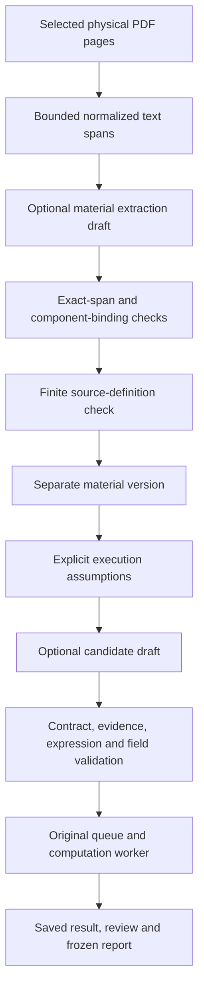

# Optional model and source workflow

Version 0.27.2 adds a bounded path from selected PDF pages to source-bound material, candidate definitions, and the existing computation worker. Ordinary installation and the public demos keep real model dispatch disabled.

## Supported operations

| Operation | Current App Server behavior |
| --- | --- |
| `extract_material` | Structured material drafts from bounded, selected PDF text spans; includes the grounded source-binding mode |
| `generate_candidates` | Candidate expression drafts for an adopted material or research context; includes the explicit formula-engineering mode |
| `repair_candidate` | Unsupported by this transport |
| `decide_next_action` | Unsupported by this transport |

The host supplies qualified native access, fixed configuration, permission, and a bounded call reservation. These operation contracts do not grant access by themselves. The adapter supervises Codex CLI App Server over stdio JSON-RPC and records proposals, attempts, receipts, and decisions in the application's persistent store.

## Source binding and unknowns

The application selects physical pages and computes bounded normalized Unicode text spans. In grounded extraction, the model returns existing span IDs; the host restores the exact quotation, page, and character offsets from its saved selection. It rejects unknown spans and inconsistent locations.

Support bindings distinguish a claim, economic mechanism, calculation, mathematical signal direction, actual data variables, and conditions. Each nonnull component requires a binding. A registered operator belongs in calculation support rather than `required_data`. Direct source support and inference carry different attribution, and missing content stays null and unresolved.

`citation_integrity=verified` means the selected quotation matches mechanically. It does not prove that the quotation entails the associated claim. Semantic fidelity and human approval are separate records.

## Two different deterministic corrections

Expression correction normalizes documented equivalents such as `correlation -> ts_corr` and approved integral window representations. Its policies preserve the formula's declared meaning.

The source-definition check follows nested AST operator dependencies and a finite set of supported formal definitions and named formula patterns, including documented aliases. The complete definition right-hand side must match a supported grammar; a correct prefix followed by altered arithmetic remains unresolved. Independent declaration boundaries and exact citation coverage are checked. A literal quotation containing an operator name is insufficient when the calculation requires a definition that the citation omits. The check also considers the source formula, window, calculation binding, and inferred-direction support.

If the necessary definition already exists in the selected spans, the bounded repair appends its citations and bindings in a new automation version. It preserves the raw draft, earlier accepted versions, hypotheses, formula, data, and scientific unknowns. Absent definitions, incorrect formulas, and inconsistent windows produce `needs_information`; the checker does not manufacture source text. A complete input may produce a zero-change verification version rather than a citation repair.

## Explicit formula engineering

Formula-engineering mode can test a calculable source formula while leaving its missing economic explanation unresolved. It requires explicit execution conditions and an exact disposition for every original unknown. The source calculation, data meanings, mathematical direction, and execution assumptions must be adequate for computation. An execution gap cannot be relabeled as a scientific unknown to pass the gate.

The candidate is then validated and submitted through the ordinary revision, queue, attempt, and worker path. The model supplies a draft, while deterministic tools compute the factor panel and evaluation metrics. Automated material versions retain `semantic_fidelity=unverified` and `human_approval=false`.

## Evidence scope

The frozen 0.27.2 Runtime accepted on 12 October 2026 recorded a bounded real extraction and candidate-generation journey followed by the original worker and saved report. It used previously seen Alpha012 from Alpha101, selecting physical pages 9, 15 and 16, and synthetic data. This is historical Runtime evidence, not validation of this later source patch or the public fixture protocol. The final extraction already contained the needed definitions, so its first automated definition check made no citation change; a separate historical counterexample was repaired through fixture/API replay without a new model call.

This establishes that these scoped components can connect. It does not establish general paper understanding, general model-driven repair, semantic quality approved by a human, time savings, or profitable trading. Underlying backend model identity, request totals, and monetary cost remain unknown where the native receipts cannot establish them. The private acceptance inputs, research records, permissions, and raw model responses remain outside this publication.

Implementation entry points: `paper_alpha/server/paper_segments.py`, `grounded_material_schema.py`, `operator_definition_grounding.py`, `material_context.py`, `paper_materials.py`, `provider_native_transport_identity.py`, and `provider_app_server_invocation.py`.
