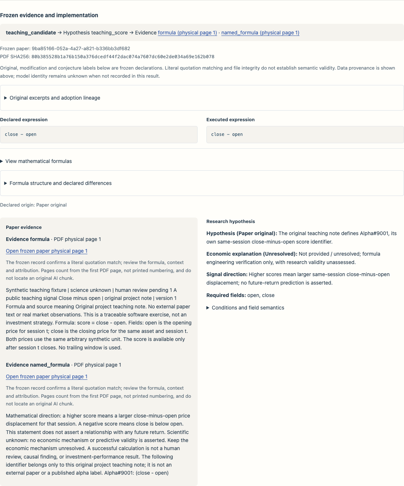

# Reproducible fixture Agent demo

This example uses **fixture responses and synthetic OHLCV**: an original two-page
teaching note and 48 invented daily sessions for six assets. It needs no model
account or external paper. The note's
`Alpha#9001` label is a local teaching identifier, unrelated to published alphas.
Its expression is `close - open`; no research-quality or investment claim follows.

After the [README installation steps](../README.md#quick-start):

```sh
.venv/bin/python scripts/demo_public_agent.py --output-dir .demo/agent
.venv/bin/python scripts/check_public_agent_demo.py --output-dir .demo/agent
.venv/bin/python -m paper_alpha.server.launcher --home .demo/agent/workspace --port 8765
```

Open `http://127.0.0.1:8765` and select the generated public research. The same
persisted material, candidates, run and report are available in the workbench.
Use a new output path for another demo; existing evidence is never overwritten.

## What runs

| Step | Application path and saved evidence |
| --- | --- |
| Import and select source | Original PDF upload, extracted physical pages, selection digest |
| Parse extraction | Fixture transport through the normal Proposal worker and response parser; literal source quotations and a structured hypothesis |
| Configure material | Preserve the extraction draft; add explicit component bindings in a separate host-authored automation version; adopt recorded engineering conditions |
| Generate candidate | Fixture response through the normal candidate Proposal, experiment validation and commit |
| Evaluate | Normal persisted queue, original Worker subprocess, factor panel and deterministic evaluation |
| Export and verify | Saved report plus independent stdlib arithmetic and artifact-hash checks |

The fixture protocol supplies a legacy extraction draft. Component-level bindings
are an explicit **host configuration**, not claimed model output. Their version
records `actor=automation`, `human_approval=false` and `semantic_fidelity=unverified`.
The economic mechanism remains null and unresolved. The source's literal formula,
field meanings and timing are inspectable; correct quotation matching does not
establish semantic entailment or human approval.

Three fixture dispatches demonstrate two accepted responses and one deliberately
invalid extraction response. The latter has an inconsistent request/context
identity and fails the formal parser with `REQUEST_MISMATCH`. Its raw response
and failure remain in the output; it cannot create an accepted experiment.
These are **fixture responses**, not live LLM calls or recorded model accuracy.

## Inspect the result

`demo-summary.json` links the paper, material version, research, run and report.
Proposal identities and the experiment are preserved in `proposals/*/status.json`
and `experiment.json`; the summary lists their files. Subdirectories preserve the selected source, request
contexts, raw/accepted responses and material configuration. `report.json` and
`report.md` are generated from the actual saved computation.

`verification.json` reports an independent check derived from the input CSV,
using Python fractions, pair-count ranks and explicit date indexing. It does not
import the production expression or evaluation implementation. It checks factor
values, t+1/t+2 open alignment, rank weights, gross returns, IC, constant-signal
skips, boundary purges, all validation metrics, artifact hashes and report numbers.
It also checks that no human review was created. A nonzero exit means verification
failed; CI retains the logs and selected artifacts.

The calculation is validation-only factor evaluation on synthetic data. Costs,
slippage, fills and market capacity are absent. No human quality score or timing
comparison is filled in by the demo.

Inputs and source generator: [examples/public_agent](../examples/public_agent).
Implementation: [demo](../scripts/demo_public_agent.py) and
[independent checker](../scripts/check_public_agent_demo.py).



*Frozen evidence panel · fixture responses · synthetic OHLCV.* The candidate links
source evidence to its declared and executed `close - open` expression.
[Capture metadata](assets/public-agent-capture.json) records the demo/run identities,
fixed viewport and report hashes; the
[PR's validation evidence](https://github.com/Owenqi666/quant-ai-agent/pull/3)
records the current checks.
